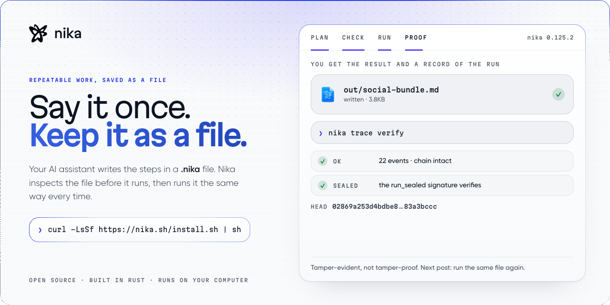
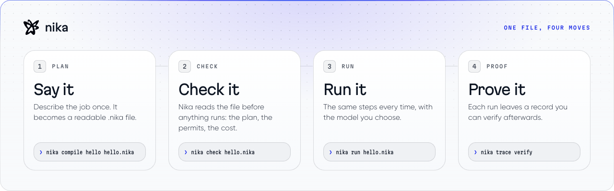
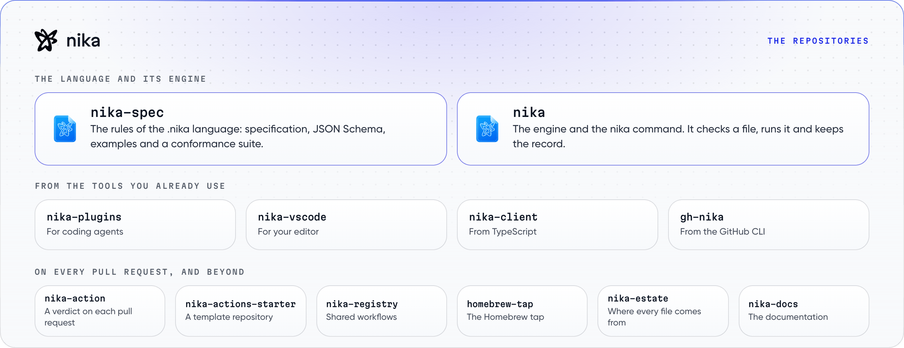

<p align="center">
  <a href="https://nika.sh">
    <picture>
      <source media="(prefers-reduced-motion: reduce) and (prefers-color-scheme: dark)" srcset="https://raw.githubusercontent.com/nika-open/.github/main/profile/assets/hero-dark.png?v=62f31fd68dd2">
      <source media="(prefers-reduced-motion: reduce)" srcset="https://raw.githubusercontent.com/nika-open/.github/main/profile/assets/hero-light.png?v=2870c7b49bcc">
      <source media="(prefers-color-scheme: dark)" type="image/webp" srcset="https://raw.githubusercontent.com/nika-open/.github/main/profile/assets/hero-dark.webp?v=be751f014251">
      <source type="image/webp" srcset="https://raw.githubusercontent.com/nika-open/.github/main/profile/assets/hero-light.webp?v=f3798b791a97">
      <source media="(prefers-color-scheme: dark)" srcset="https://raw.githubusercontent.com/nika-open/.github/main/profile/assets/hero-dark.gif?v=f29aa99df4bc">
      
    </picture>
  </a>
</p>

# Nika

**Checked before it runs. Run with the model you choose. Proven afterwards.**

Nika is an open-source workflow language and engine for the work you repeat. You describe a job
once, or your AI assistant writes it for you, and you keep it as a readable `.nika` file: its
steps, the tools it may use and its limits. Nika inspects the file before anything runs, runs it
with the model you choose, and keeps a record you can verify.

**[nika.sh](https://nika.sh)** · [Docs](https://docs.nika.sh) · [Engine](https://github.com/nika-open/nika) · [Specification](https://github.com/nika-open/nika-spec) · [Releases](https://github.com/nika-open/nika/releases)

## One file, four moves

<p align="center">
  <a href="https://github.com/nika-open/nika#see-it-in-four-steps">
    <picture>
      <source media="(prefers-reduced-motion: reduce) and (prefers-color-scheme: dark)" srcset="https://raw.githubusercontent.com/nika-open/.github/main/profile/assets/steps-dark.png?v=a902acbdbf87">
      <source media="(prefers-reduced-motion: reduce)" srcset="https://raw.githubusercontent.com/nika-open/.github/main/profile/assets/steps-light.png?v=05e5016a63bc">
      <source media="(prefers-color-scheme: dark)" type="image/webp" srcset="https://raw.githubusercontent.com/nika-open/.github/main/profile/assets/steps-dark.webp?v=7b9d488d638d">
      <source type="image/webp" srcset="https://raw.githubusercontent.com/nika-open/.github/main/profile/assets/steps-light.webp?v=32b71a46d5d5">
      <source media="(prefers-color-scheme: dark)" srcset="https://raw.githubusercontent.com/nika-open/.github/main/profile/assets/steps-dark.gif?v=0b643240acde">
      
    </picture>
  </a>
</p>

```sh
curl -LsSf https://nika.sh/install.sh | sh   # macOS and Linux
brew install nika-open/tap/nika              # Homebrew
```

```sh
nika compile hello hello.nika   # write a first workflow
nika check hello.nika           # inspect it: nothing runs, no model is called
nika run hello.nika             # run it
nika trace verify               # verify the record of that run
```

## Inspected before it runs

Nika is the roadworthiness inspection of AI automations: the agent writes the workflow, and Nika
inspects it before it runs.

```yaml
nika: use-a-tool
permits:
  tools: ["nika:fetch"]
  net: { http: ["nika.sh"] }
tasks:
  page:
    invoke:
      tool: "nika:fetch"
      args: { url: "https://nika.sh" }
```

`nika check use-a-tool.nika` audits this file before it runs: the plan, the cost, the secrets, the
types and the permits. Remove the `net` line and the check refuses the file, because `nika:fetch`
would reach a host the file never declared. The verdict is static, deterministic, local and
portable. It also says what it did not judge: a price it could not find, a path computed at run
time, the answer a model will give.

The language has 4 verbs, 18 providers, 30 builtin tools. `infer` asks a model from one of those
providers, `exec` runs a program, `invoke` calls a tool, and `agent` lets a model work in a loop.
The specification's [`canon.yaml`](https://github.com/nika-open/nika-spec/blob/main/canon.yaml)
holds these counts.

## Repositories

<p align="center">
  <picture>
    <source media="(prefers-color-scheme: dark)" srcset="https://raw.githubusercontent.com/nika-open/.github/main/profile/assets/family-dark.png?v=4cfc8ec611de">
    
  </picture>
</p>

| Repository | What it is |
|---|---|
| [**nika**](https://github.com/nika-open/nika) | The engine and the `nika` CLI, written in Rust. |
| [**nika-spec**](https://github.com/nika-open/nika-spec) | The open specification of the `.nika` language: rules, JSON Schema, examples and conformance suite. |
| [**nika-client**](https://github.com/nika-open/nika-client) | The TypeScript SDK. The engine ships inside the package. |
| [**nika-docs**](https://github.com/nika-open/nika-docs) | The source of [docs.nika.sh](https://docs.nika.sh). |
| [**nika-plugins**](https://github.com/nika-open/nika-plugins) | Nika for coding agents: Claude Code and Cursor plugins, and the MCP server metadata. |
| [**nika-vscode**](https://github.com/nika-open/nika-vscode) | The editor extension for VS Code, Cursor, Windsurf and VSCodium. |
| [**nika-action**](https://github.com/nika-open/nika-action) | A GitHub Action that gives every pull request changing a workflow a verdict, before anything runs. |
| [**nika-actions-starter**](https://github.com/nika-open/nika-actions-starter) | A template repository with two working workflows and the CI that checks them. |
| [**gh-nika**](https://github.com/nika-open/gh-nika) | Nika as a GitHub CLI extension: `gh nika`. |
| [**homebrew-tap**](https://github.com/nika-open/homebrew-tap) | The Homebrew tap. |
| [**nika-registry**](https://github.com/nika-open/nika-registry) | Find a shared workflow, run it by name, and know it is exactly what was reviewed. |
| [**nika-estate**](https://github.com/nika-open/nika-estate) | Says where every file in Nika comes from, and lets you check it yourself. |

The engine is licensed under AGPL-3.0-or-later and the specification under Apache-2.0; each
repository states its own license. To report a vulnerability, follow the
[security policy](https://github.com/nika-open/nika/security/policy).

---

<sub>Nika is created and maintained by [Thibaut Mélen](https://github.com/ThibautMelen) · SuperNovae Studio.</sub>
