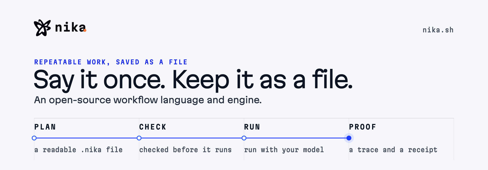

<p align="center">
  <a href="https://nika.sh">
    <picture>
      <source media="(prefers-color-scheme: dark)" srcset="https://raw.githubusercontent.com/nika-open/.github/main/profile/assets/banner-dark.png">
      
    </picture>
  </a>
</p>

<p align="center">
  <a href="https://nika.sh"><b>nika.sh</b></a> ·
  <a href="https://docs.nika.sh">Docs</a> ·
  <a href="https://github.com/nika-open/nika">Engine</a> ·
  <a href="https://github.com/nika-open/nika-spec">Specification</a> ·
  <a href="https://github.com/nika-open/nika/releases">Releases</a>
</p>

Nika automates the work you repeat. You describe a job once and keep it as a readable `.nika`
file: its steps, the tools it may use and its limits. Nika checks the file before anything runs,
runs it with the model you choose, and keeps a record of what happened.

## Install

```sh
curl -LsSf https://nika.sh/install.sh | sh   # macOS and Linux
brew install nika-open/tap/nika              # Homebrew
```

## A first workflow

```yaml
nika: use-a-tool
permits:
  tools: ["nika:fetch"]
  net: { http: ["nika.sh"] }
tasks:
  page:
    invoke:
      tool: "nika:fetch"
      args: { url: "https://nika.sh" }
```

`nika check use-a-tool.nika` audits it before it runs: the plan, the cost, the secrets, the types
and the permits. Remove the `net` line and the check refuses the file, because `nika:fetch` would
reach a host the file never declared. `nika run use-a-tool.nika` runs it and records a trace in
`.nika/traces/`.

The language has 4 verbs, 18 providers, 30 builtin tools. `infer` asks a model from one of those
providers, `exec` runs a program, `invoke` calls a tool, and `agent` lets a model work in a loop.
The specification's [`canon.yaml`](https://github.com/nika-open/nika-spec/blob/main/canon.yaml)
holds these counts.

## Repositories

| Repository | What it is |
|---|---|
| [**nika**](https://github.com/nika-open/nika) | The engine and the `nika` CLI, written in Rust. |
| [**nika-spec**](https://github.com/nika-open/nika-spec) | The open specification of the `.nika` language: rules, JSON Schema, examples and conformance suite. |
| [**nika-client**](https://github.com/nika-open/nika-client) | The TypeScript SDK. The engine ships inside the package. |
| [**nika-docs**](https://github.com/nika-open/nika-docs) | The source of [docs.nika.sh](https://docs.nika.sh). |
| [**nika-plugins**](https://github.com/nika-open/nika-plugins) | Nika for coding agents: Claude Code and Cursor plugins, and the MCP server metadata. |
| [**nika-vscode**](https://github.com/nika-open/nika-vscode) | The editor extension for VS Code, Cursor, Windsurf and VSCodium. |
| [**nika-action**](https://github.com/nika-open/nika-action) | A GitHub Action that gives every pull request changing a workflow a verdict, before anything runs. |
| [**nika-actions-starter**](https://github.com/nika-open/nika-actions-starter) | A template repository with two working workflows and the CI that checks them. |
| [**gh-nika**](https://github.com/nika-open/gh-nika) | Nika as a GitHub CLI extension: `gh nika`. |
| [**homebrew-tap**](https://github.com/nika-open/homebrew-tap) | The Homebrew tap. |
| [**nika-registry**](https://github.com/nika-open/nika-registry) | Find a shared workflow, run it by name, and know it is exactly what was reviewed. |
| [**nika-estate**](https://github.com/nika-open/nika-estate) | Says where every file in Nika comes from, and lets you check it yourself. |

The engine is licensed under AGPL-3.0-or-later and the specification under Apache-2.0; each
repository states its own license. To report a vulnerability, follow the
[security policy](https://github.com/nika-open/nika/security/policy).

---

<sub>Nika is created and maintained by [Thibaut Mélen](https://github.com/ThibautMelen) · SuperNovae Studio.</sub>
